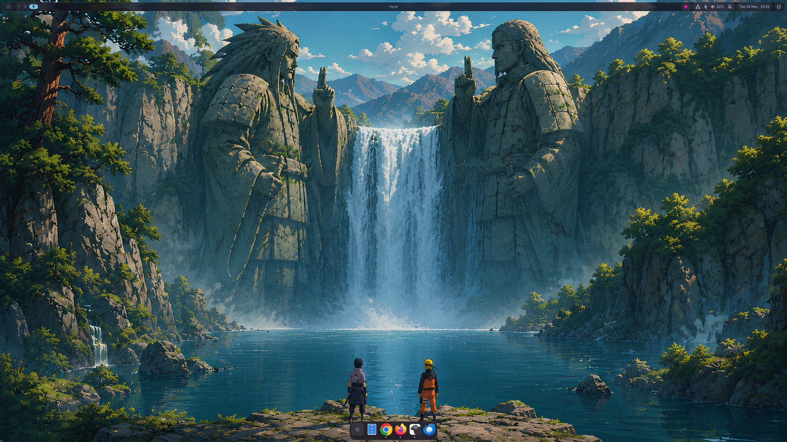
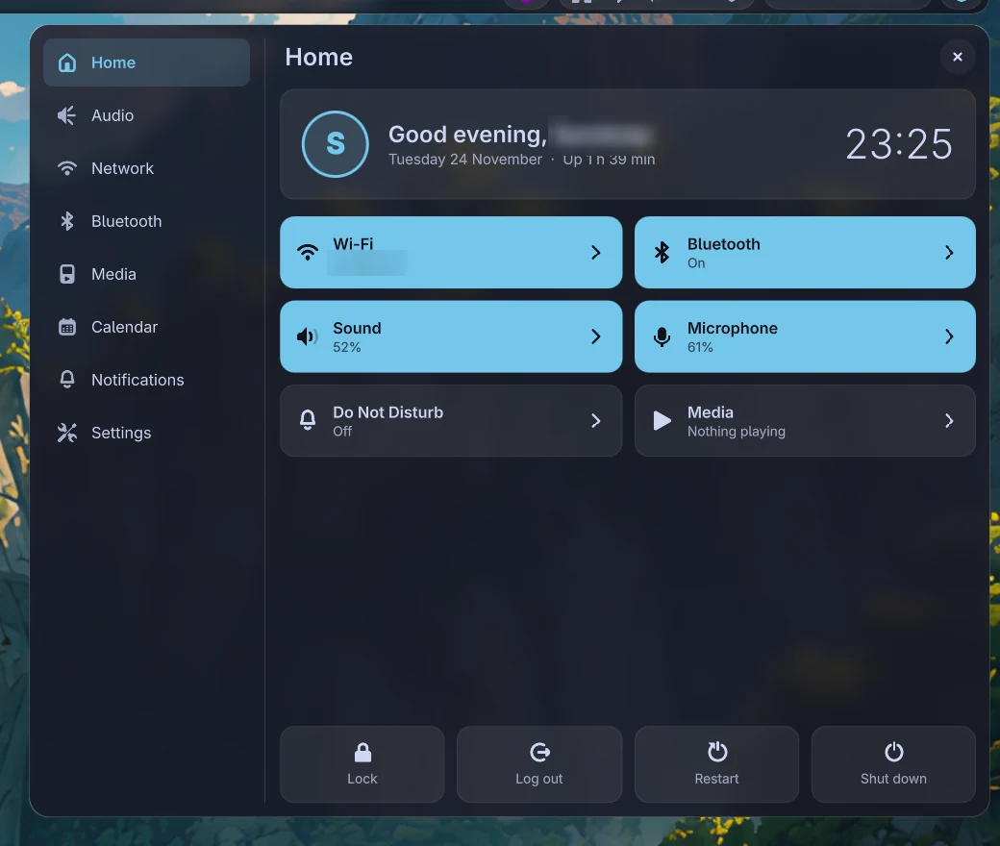
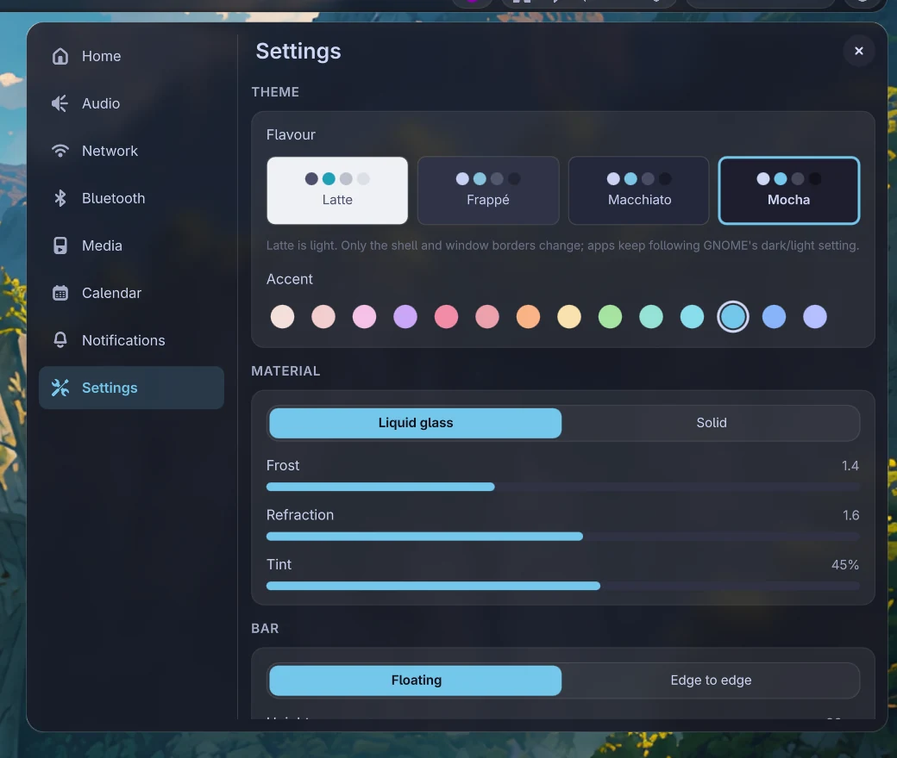
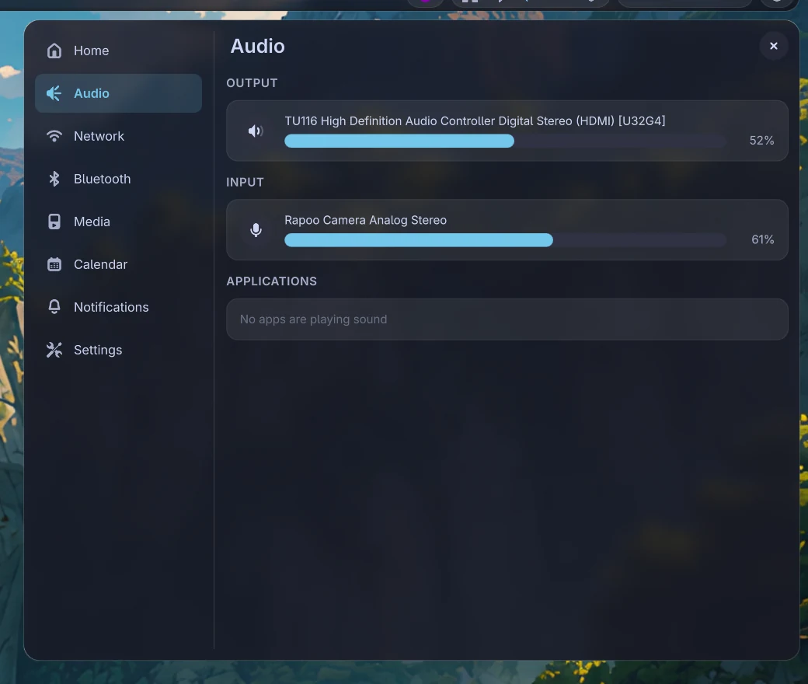
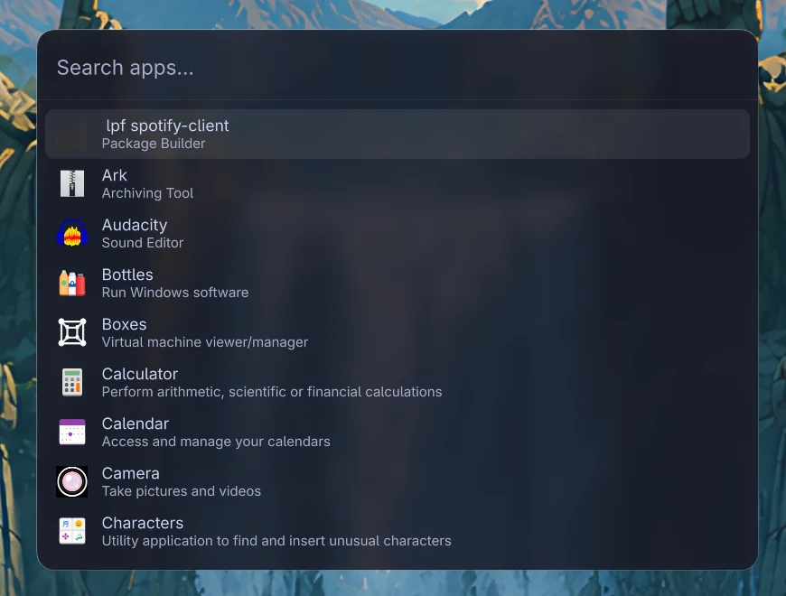
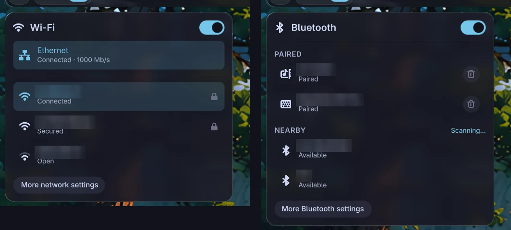
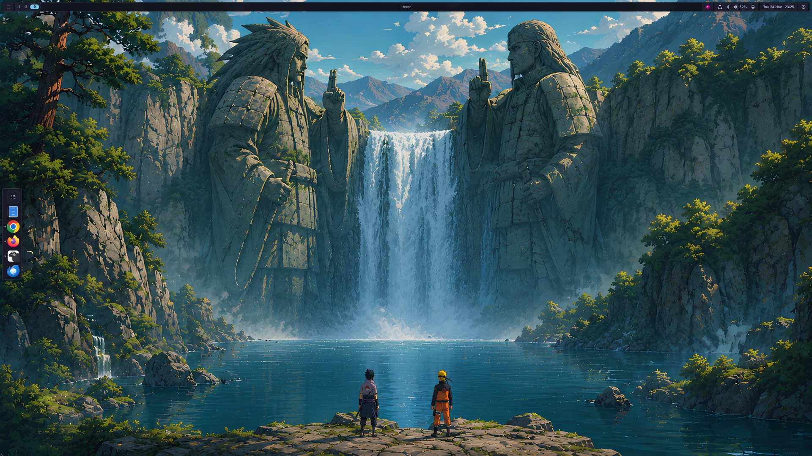

# linux-desktop-rice

My Hyprland desktop on Fedora: a [Quickshell](https://quickshell.org) shell with a floating bar, a
Noctalia-style control center, a macOS-style dock, and optional Apple-style liquid glass.
It runs next to GNOME: pick either session on the login screen.



> Reproducing this on another machine, or pointing an AI agent at it? Read [AGENTS.md](AGENTS.md):
> architecture, versions, setup on other distros, how to verify each piece, and the gotchas.

## Screenshots

| Control Center | Settings |
|---|---|
|  |  |
| **Audio** | **Launcher** (Super+Space) |
|  |  |

Wi-Fi and Bluetooth pickers drop down from their bar icons (network and device names blurred):



Dock with magnification, drag to reorder, and running indicators:


Same shell with **Solid** material, square corners and the dock on the left, all set from the
Settings tab:



## What's in it

- **Bar**: floating, rounded. Launcher button, workspaces, focused window title, tray, now playing,
  network, Bluetooth, volume, notifications, clock, session. Status icons open their panel, which
  grows out of the icon you clicked.
- **Control Center**: Home (greeting, quick toggles, lock/log out/restart/shut down), Audio (output,
  input, per-app volume), Network (Wi-Fi list with password prompt), Bluetooth, Media (MPRIS),
  Calendar, Notifications (history, Do Not Disturb), Settings.
- **Wi-Fi and Bluetooth pickers** that drop down from their bar icons.
- **Launcher** (Super+Space) with fuzzy and initials matching.
- **Dock**: pinned and running apps, magnification, drag to reorder / keep / remove, right-click
  menu, auto-hide; bottom, left or right.
- **Notification** pop-ups, a **volume pop-up**, **lock screen** (hyprlock) and **idle** handling
  (hypridle).
- **Settings tab**: 12 themes (Catppuccin Latte/Frappé/Macchiato/Mocha, Tokyo Night, Nord, Gruvbox,
  Rosé Pine, Rosé Pine Dawn, Dracula, Everforest, Kanagawa), each with its own accents; liquid glass
  or solid, glass frost/refraction/tint, bar style/height/roundness, animation speed, dock options,
  wallpaper. Saved to `~/.config/quickshell/settings.json`; applies live, window borders included.

## Requirements

Built and used on Fedora 44 with Hyprland 0.57 (Lua config) and Quickshell 0.3.2.

```bash
sudo dnf copr enable sdegler/hyprland            # Hyprland and its tools
sudo dnf copr enable errornointernet/quickshell  # Quickshell 0.3.x
sudo dnf install --setopt=install_weak_deps=False \
  hyprland xdg-desktop-portal-hyprland hyprland-guiutils hyprpolkitagent \
  hyprlauncher hyprlock hypridle quickshell
```

Also used if present: `kitty` (terminal), `nautilus` (files), `flameshot` (screenshots),
`gnome-control-center` (opened for detailed network/sound settings), Adwaita icons and the
Adwaita Sans font (Fedora Workstation defaults). Other distros: see [AGENTS.md](AGENTS.md).

## Install

```bash
git clone https://github.com/MrSunshyne/linux-desktop-rice
cd linux-desktop-rice
./install.sh
```

`install.sh` copies `config/` into `~/.config` (moving anything already there to
`<name>.bak-<timestamp>`) and the wallpaper into `~/Pictures/Wallpapers`. Then:

1. Edit the monitor block near the top of `~/.config/hypr/hyprland.lua` (output name, mode, scale).
   `hyprctl monitors all` lists your outputs and modes.
2. Log out and choose **Hyprland** on the login screen.
3. Open the Control Center (⏻ in the bar) → Settings to pick the wallpaper and style.

`config/quickshell/settings.json` holds my current choices. Delete it before installing to start
from the defaults instead (Catppuccin Mocha, liquid glass, rounded, dock at the bottom).

To save changes you make on your machine back into the repo, run `./sync.sh`, review `git diff`,
then commit.

## Liquid glass (optional)

The glass look comes from the [hyprglass](https://github.com/hyprnux/hyprglass) Hyprland plugin.
It's a native plugin that must match your Hyprland version exactly, so it isn't in this repo.
`hyprland.lua` loads `~/.local/share/hyprland/plugins/hyprglass.so` if it exists; point that at
the release built for your Hyprland (`hyprctl version`):

```bash
mkdir -p ~/.local/share/hyprland/plugins && cd ~/.local/share/hyprland/plugins
curl -L -o hyprglass-1.2.0.so https://github.com/hyprnux/hyprglass/releases/download/v1.2.0/hyprglass.so
sha256sum hyprglass-1.2.0.so
# 5515cf25b1d55545d3ff27f4879346eb7545ae166a065efec2208c486cd6e009 (v1.2.0, built for Hyprland 0.57.2)
ln -sfn hyprglass-1.2.0.so hyprglass.so
```

Log out and back in (or save `hyprland.lua` to reload it); `hyprctl hyprglass status` should say
`active`, and Settings → Material → Liquid glass becomes available. On a version mismatch the plugin
pauses itself and the shell stays solid. After a Hyprland update, download the matching release (or
build with `hyprpm`) and repoint the `hyprglass.so` link.

## Keys

| Keys | Action |
|---|---|
| Super+Space | Launcher |
| Super+Q | Terminal (kitty) |
| Super+E | Files |
| Super+R | hyprlauncher (fallback launcher) |
| Super+C | Close window |
| Super+V | Toggle floating |
| Super+L | Lock |
| Super+M | Log out |
| Super+←↑→↓ | Move focus |
| Super+1…0 / Super+Shift+1…0 | Switch to / move window to workspace |
| Super+S / Super+Shift+S | Scratchpad / move window there |
| Super+drag (left / right button) | Move / resize window |

## Layout

```
config/
  hypr/hyprland.lua          Hyprland (Lua config): monitor, autostart, glass, keys, rules
  hypr/hypridle.conf         lock + screen off at 15 min, suspend at 100 min
  hypr/hyprlock.conf         lock screen
  systemd/user/hyprland-session.target   lets xdg-desktop-portal start under Hyprland
  quickshell/
    shell.qml                entry point
    Theme.qml, Settings.qml  look and saved settings (settings.json)
    *Service.qml, Panels.qml shared state (audio, network, media, notifications, panels)
    Bar, Dock, ControlCenter, Launcher, BarPicker, NotificationPopups, VolumeOsd, Wallpaper
    cc/                      Control Center tabs
    ui/                      reusable widgets
    themes.js                all themes: role colours + accent lists (adds to palettes.js)
    palettes.js              Catppuccin palettes (generated from catppuccin/palette)
wallpapers/                  the wallpaper in the screenshots
docs/screenshots/            README images (private text blurred)
```

Settings also writes `~/.config/hypr/look.lua` (border colours, glass, bar shape, animations), which
`hyprland.lua` reads. It's generated per machine and not tracked.

## Notes

- Bluetooth devices that need a PIN confirmation to pair can't be paired from the panel (no pairing
  agent in this session); pair them once from GNOME or `bluetoothctl`.
- Notification history is kept in memory and clears when Quickshell restarts.

## Credits

[Quickshell](https://quickshell.org) · [Hyprland](https://hypr.land) ·
[Catppuccin](https://catppuccin.com) · [hyprglass](https://github.com/hyprnux/hyprglass) ·
ideas from [Noctalia](https://github.com/noctalia-dev/noctalia) and
[cachyos-rice](https://github.com/thecodedrops/cachyos-rice).
